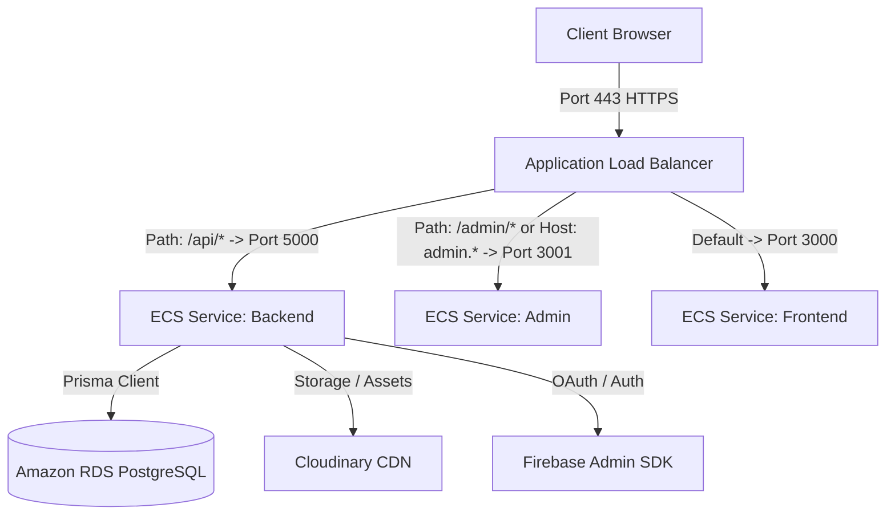

# AWS Production Deployment Guide: Zari & Co

This guide details a professional, production-grade deployment of the three Docker containers (Frontend on port 3000, Admin on port 3001, Backend on port 5000) using **AWS ECS Fargate**, **Amazon ECR**, **Application Load Balancer (ALB)**, and **Amazon RDS PostgreSQL**.

---

## 1. Architectural Overview

The diagram below represents the production network topology on AWS:



- **ECS Fargate**: Serverless container orchestration. No EC2 instances to manage.
- **ALB (Application Load Balancer)**: Evaluates path-based routing (e.g. `/api/*` goes to Backend, others go to Frontend/Admin) or host-based routing (e.g., `admin.example.com` goes to Admin, `example.com` goes to Frontend).
- **RDS PostgreSQL**: Multi-AZ fully managed SQL database.

---

## 2. Step 1: Push Containers to Amazon ECR (Elastic Container Registry)

Create three private repositories in Amazon ECR: `zari-co-frontend`, `zari-co-admin`, and `zari-co-backend`.

```bash
# 1. Authenticate Docker CLI to your ECR registry
aws ecr get-login-password --region <aws-region> | docker login --username AWS --password-stdin <aws-account-id>.dkr.ecr.<aws-region>.amazonaws.com

# 2. Build and tag the Backend image
docker build -t zari-co-backend ./backend
docker tag zari-co-backend:latest <aws-account-id>.dkr.ecr.<aws-region>.amazonaws.com/zari-co-backend:latest
docker push <aws-account-id>.dkr.ecr.<aws-region>.amazonaws.com/zari-co-backend:latest

# 3. Build and tag the Frontend image (Injecting production API URL)
docker build --build-arg VITE_API_URL=https://api.yourdomain.com/api/v1 -t zari-co-frontend ./frontend
docker tag zari-co-frontend:latest <aws-account-id>.dkr.ecr.<aws-region>.amazonaws.com/zari-co-frontend:latest
docker push <aws-account-id>.dkr.ecr.<aws-region>.amazonaws.com/zari-co-frontend:latest

# 4. Build and tag the Admin image (Injecting production API URL)
docker build --build-arg VITE_API_URL=https://api.yourdomain.com/api/v1 -t zari-co-admin ./admin
docker tag zari-co-admin:latest <aws-account-id>.dkr.ecr.<aws-region>.amazonaws.com/zari-co-admin:latest
docker push <aws-account-id>.dkr.ecr.<aws-region>.amazonaws.com/zari-co-admin:latest
```

---

## 3. Step 2: Provision RDS PostgreSQL Database

1. Spin up an **Amazon RDS PostgreSQL** instance (v15+) inside your private subnets.
2. Configure the Security Group of the RDS instance to accept inbound PostgreSQL traffic (port 5432) **only** from the Security Group associated with the ECS Backend service.
3. Take note of the connection details to form your `DATABASE_URL`:
   `postgresql://<username>:<password>@<rds-endpoint>:5432/<db-name>?schema=public`

---

## 4. Step 3: Configure AWS Secrets Manager
For professional security, store the backend `.env` variables inside **AWS Secrets Manager** as key-value pairs (or individual secrets):
- `DATABASE_URL`
- `ACCESS_TOKEN_SECRET`
- `REFRESH_TOKEN_SECRET`
- `CLOUDINARY_API_SECRET`
- `FIREBASE_SERVICE_ACCOUNT`

Pass these secrets dynamically to the ECS Task Definition to avoid exposing sensitive tokens in plain text code.

---

## 5. Step 4: Define ECS Task Definitions & Target Groups

### Target Groups Setup
Create three target groups in your AWS console or Terraform configuration:

| Service | Target Group Name | Target Port | Protocol | Health Check Path | Success Codes |
| :--- | :--- | :--- | :--- | :--- | :--- |
| **Frontend** | `tg-zari-co-frontend` | `3000` | HTTP | `/` | 200 |
| **Admin** | `tg-zari-co-admin` | `3001` | HTTP | `/` | 200 |
| **Backend** | `tg-zari-co-backend` | `5000` | HTTP | `/health` | 200 |

> [!TIP]
> Ensure the Backend target group's health check is pointed to the `/health` endpoint. The Fargate agent will query this route to verify database connectivity before routing user traffic.

### ECS Task Definition Templates

Create task definitions for each service under ECS Fargate:

#### Backend Fargate Task
- **Image**: `<aws-account-id>.dkr.ecr.<aws-region>.amazonaws.com/zari-co-backend:latest`
- **Port Mapping**: Container Port `5000` (TCP)
- **Environment / Secrets**: 
  - `PORT`: `5000`
  - `NODE_ENV`: `production`
  - `CORS_ORIGINS`: `https://yourdomain.com,https://admin.yourdomain.com`
  - Inject other database/Cloudinary credentials from AWS Secrets Manager.

#### Frontend Fargate Task
- **Image**: `<aws-account-id>.dkr.ecr.<aws-region>.amazonaws.com/zari-co-frontend:latest`
- **Port Mapping**: Container Port `3000` (TCP)

#### Admin Fargate Task
- **Image**: `<aws-account-id>.dkr.ecr.<aws-region>.amazonaws.com/zari-co-admin:latest`
- **Port Mapping**: Container Port `3001` (TCP)

---

## 6. Step 5: Configure Application Load Balancer Routing

Attach your ALB to a public-facing HTTPS listener (Port 443) using an SSL Certificate from AWS Certificate Manager (ACM). Set up the following routing rules:

1. **Rule 1 (Path Pattern `/api/*`)** -> Forward traffic to `tg-zari-co-backend` (Backend on port 5000)
2. **Rule 2 (Path Pattern `/health` or `/api/v1/health`)** -> Forward traffic to `tg-zari-co-backend`
3. **Rule 3 (Host Header `admin.yourdomain.com` or Path Pattern `/admin/*`)** -> Forward traffic to `tg-zari-co-admin` (Admin on port 3001)
4. **Default Rule (Catch-all)** -> Forward traffic to `tg-zari-co-frontend` (Frontend on port 3000)

---

## 7. Step 6: Run Database Migrations on AWS
Since the RDS instance resides in private subnets, running database migrations directly from a local terminal is blocked. Run database migrations inside AWS professionally using one of two methods:

### Option A: Run a One-Off ECS Task (Recommended)
Launch a temporary Fargate task using the `zari-co-backend` image, overriding the command to run the migrations:
```bash
aws ecs run-task \
  --cluster <your-ecs-cluster-name> \
  --task-definition <backend-task-definition-arn> \
  --overrides '{"containerOverrides": [{"name": "backend", "command": ["npx", "prisma", "migrate", "deploy"]}]}' \
  --launch-type FARGATE \
  --network-configuration '{"awsvpcConfiguration": {"subnets": ["<private-subnet-1>", "<private-subnet-2>"], "securityGroups": ["<backend-security-group>"]}}'
```

### Option B: CI/CD Pipeline Integration
Inject migration execution inside your GitHub Actions or AWS CodePipeline steps before updating the ECS service.
