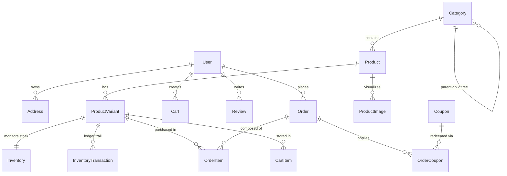

# 💎 Zari & Co Backend API

A highly structured, production-grade, and scalable RESTful API backend for the **Zari & Co** e-commerce platform. Built with a modular modular-monolith structure using **Node.js (ESM)**, **Express.js**, **TypeScript**, and **Prisma ORM** backed by **PostgreSQL**.

---

## 🚀 Tech Stack & Core Libraries

- **Runtime & Module System:** Node.js (v18+) with native ES Modules (`"type": "module"`)
- **Framework:** Express.js v5.2 (utilizing modern request/response interfaces)
- **Programming Language:** TypeScript v6.0+ (strictly typed compilation)
- **Database ORM:** Prisma Client v7.8 with custom output generation
- **Database Engine:** PostgreSQL (utilizing `@prisma/adapter-pg` with connection pooling)
- **Schema & Environment Validation:** Zod v4.4
- **Security & Cryptography:** 
  - JWT (JSON Web Tokens) for session validation (access/refresh tokens)
  - HTTP-Only, Secure, SameSite=Strict cookies to protect against CSRF and XSS
  - bcrypt for secure password hashing
- **High-Performance Logging:** Pino v10.3 (with `pino-pretty` console output in development and automatic redaction of credentials)

---

## 📁 Project Architecture & Structure

The codebase utilizes a modular, feature-based design inside the `src/` directory. This keeps domain logic isolated, easily testable, and highly maintainable.

```text
backend/
├── dist/                   # Compiled JavaScript files (generated by tsc)
├── generated/              # Custom output directory for the Prisma Client
├── prisma/                 # Database schema definitions and migrations
│   ├── migrations/         # Auto-generated SQL schema migrations
│   └── schema.prisma       # Prisma Schema defining Enums, Models, and Indexes
├── src/                    # Source code
│   ├── config/             # Global configurations & setups
│   │   ├── db.ts           # Prisma Client instance with pg connection pool & adapter
│   │   ├── env.ts          # Strongly typed environment variables parsed via Zod
│   │   ├── logger.ts       # Pino logger with credential-redacting paths
│   │   ├── rabbitmq.ts     # [Placeholder] Message Queue connection configuration
│   │   └── redis.ts        # [Placeholder] Cache store configuration
│   ├── modules/            # Isolated domain feature modules
│   │   ├── auth/           # Authentication endpoints (controllers, validation, routes)
│   │   ├── catalog/        # Product, Category, and Variant services & routers
│   │   ├── users/          # User profiling, accounts, and administrator controls
│   │   ├── orders/         # [Placeholder] Future Order checkout & history logic
│   │   └── payment/        # [Placeholder] Future Stripe / payment gateway logic
│   ├── shared/             # Shared utilities across multiple modules
│   │   ├── exceptions/     # Custom error classes (ApiError, ApiResponse)
│   │   ├── middlewares/    # Express middlewares (Authentication, error boundary)
│   │   └── utils/          # Standard utility helpers (asyncHandler, cookie & token helpers)
│   ├── worker/             # [Placeholder] Background queue handlers & worker scripts
│   ├── app.ts              # Express server orchestration & middleware pipelines
│   └── server.ts           # Entry point: Database connection, listener startup, SIGTERM handles
├── .env                    # System environment file
├── tsconfig.json           # TypeScript compilation configuration
└── package.json            # Scripts and project dependencies
```

---

## 🗄️ Database Architecture (Prisma Models)

The data model inside `prisma/schema.prisma` is optimized for performance, scalability, and audit-readiness.



### Key Schema Highlights
1. **Ledger-Style Inventory System:**
   - **`Inventory`**: Stores the absolute stock levels (`quantity` on hand, `reservedQuantity` in pending orders, `lowStockThreshold`).
   - **`InventoryTransaction`**: An **append-only ledger** (never updated or deleted) tracking all stock delta adjustments (restock, sale, returns, adjustments, reserves, damage). This provides high auditability and transactional reliability.
2. **Flexible E-Commerce Catalog:**
   - **`Category`**: Supports hierarchical category trees (`parent` and `children` self-relations).
   - **`Product` & `ProductVariant`**: Every purchasable item is associated with a specific variant. This supports attributes (stored as dynamic `Json` for size, color, metal purity, etc.) and allows base prices to be overridden at the variant level.
3. **Robust Promotions & Feedback:**
   - **`Coupon` & `OrderCoupon`**: Multi-use coupons validating against dates, minimum cart thresholds, and maximum discount limits.
   - **`Review`**: Restricts reviews to one per product per user to prevent ratings spam, while tracking `isVerifiedPurchase` and administrator-mediated publication flags.

---

## 🛠️ Local Development & Setup

### 1. Clone & Install Dependencies
Navigate to your backend directory and install the required Node modules:
```bash
npm install
```

### 2. Environment Variables (`.env`)
Create a `.env` file in the root of the `backend/` directory. Below is the list of keys strictly validated by the application schema in `src/config/env.ts`:

```env
PORT=5000
NODE_ENV=development
DATABASE_URL="postgresql://<user>:<password>@localhost:5432/<database_name>?schema=public"

# Token Secret Keys (Use long secure strings in production)
ACCESS_TOKEN_SECRET="your_access_token_secret"
REFRESH_TOKEN_SECRET="your_refresh_token_secret"

# Token Expirations
ACCESS_TOKEN_EXPIRES="15m"
REFRESH_TOKEN_EXPIRES="7d"
```

### 3. Database Initial Migration & Client Generation
Run Prisma commands to set up the database schema and generate the client into the custom `./generated/prisma` directory:
```bash
npx prisma generate
npx prisma db push
```

### 4. Running the Development Server (Dual-Process Flow)
Since the `package.json` configurations are designed to run nodemon against the *compiled* JS files under the `dist/` directory, **you must run both compilation and the execution processes concurrently during development**.

1. **Terminal 1 - TS Compiler (Watch Mode):**
   This watches your `.ts` source files in `src/` and compiles them instantly to `/dist` on save:
   ```bash
   npm run watch
   ```

2. **Terminal 2 - Nodemon Server Execution:**
   This monitors the compiled files under `/dist` and restarts the application server whenever a compilation output changes:
   ```bash
   npm run dev
   ```

### 5. Production Compilations
To compile and execute the application in production mode:
```bash
npm run build
```

---

## 🛣️ API Endpoints Summary

### 🔑 Authentication Module (`/api/v1/auth`)
- `POST /register`: Registers a new user account with hashed passwords.
- `POST /login`: Authenticates credentials and issues HttpOnly Cookies.
- `POST /refresh-token`: Rotates access tokens securely.
- `POST /logout`: Clears HttpOnly cookies and terminates session tokens.

### 👥 Users Module (`/api/v1/users`)
- `GET /`: Lists all users (Admin only).
- `GET /:id`: Retrieves profile details for a specific user.
- `DELETE /:id`: Deletes a user profile (Admin only).

### 🏠 Address Book Sub-Module (`/api/v1/users/address`)
- `POST /address`: Creates a new shipping/billing address. Automatically enforces the **Single Default Address** rule.
- `GET /address`: Retrieves all active addresses for the authenticated user.
- `GET /address/:id`: Gets details for a specific address.
- `PUT /address/:id`: Updates an address, handles default resets.
- `DELETE /address/:id`: Safely unlinks and deletes an address. Promotes the next available sibling to default automatically if the deleted one was default.

### 💍 Catalog Module (`/api/v1/catalog`)
- `GET /product`: Lists all products in the catalogue.
- `POST /product`: Creates a new product catalog item.
- `PUT /product/:id`: Updates a product's text and rich parameters.
- `DELETE /product/:id`: Unlinks a product record.

### 🖼️ Product Media Sub-Module (`/api/v1/catalog/product/:productId/images`)
- `POST /product/:productId/images`: Uploads multiple images (supports up to 10 files simultaneously) via secure **Multer** middlewares. Validates against size limits (max 10MB) and image types (`JPEG, PNG, WEBP, GIF`).
- `DELETE /image/:id`: Deletes an image record from PostgreSQL and unlinks the physical asset from the local disk. Promotes the next available sibling if the deleted cover was primary.
- `PUT /image/:id/primary`: Instantly updates and marks the selected asset as the main primary thumbnail cover.

### 🧬 Product Variant Sub-Module (`/api/v1/catalog`)
- `POST /product/:productId/variants`: Creates a new product variant. Executes a transactional query that automatically initializes matching, zero-stock **Inventory** rows in PostgreSQL.
- `GET /product/:productId/variants`: Lists all variants for a specific product alongside active inventory levels.
- `GET /variant/:id`: Retrieves specific variant details (includes nested product references and stock summaries).
- `PUT /variant/:id`: Updates variant attributes, names, price overrides, and active statuses.
- `DELETE /variant/:id`: Safely unlinks and deletes a variant, cascading physical and inventory unlinks safely.

---

---

## 🔌 API Endpoints Documentation

All routes are versioned and prefix-nested under `/api/v1/`.

### 1. Authentication Module (`/api/v1/auth`)

Handles user signups, credentials verification, and secure cookie sessions.

| Endpoint | HTTP Method | Access Level | Description |
| :--- | :--- | :--- | :--- |
| `/register` | `POST` | Public | Register a new user profile with verification status. |
| `/login` | `POST` | Public | Verify credentials, issue `accessToken` & `refreshToken` in HttpOnly cookies. |
| `/logout` | `GET` | User / Admin | Clear the HTTP-Only cookies and terminate active session. |

### 2. Users Module (`/api/v1/users`)

Allows user account details management and administrator operations.

| Endpoint | HTTP Method | Access Level | Description |
| :--- | :--- | :--- | :--- |
| `/` | `GET` | Admin | Get list of all registered users (supports soft-deleted filters). |
| `/:id` | `GET` | User / Admin | Get detailed profile of a single user by their UUID. |
| `/:id` | `DELETE` | User / Admin | Soft-delete a user profile from the database. |

### 3. Catalog Module (`/api/v1/catalog`)

Handles categories tree management and item listings.

| Endpoint | HTTP Method | Access Level | Description |
| :--- | :--- | :--- | :--- |
| `/category` | `POST` | Public / Admin | Create a new product category (with sorting and parent category mappings). |
| `/category` | `GET` | Public | Get the full flat list of published categories. |
| `/category/:id` | `GET` | Public | Get details of a single category by its UUID. |
| `/category/:id` | `PUT` | Public / Admin | Modify the attributes, slug, name, or publish status of a category. |
| `/category/:id` | `DELETE` | Public / Admin | Delete a category from the system. |
| `/product` | *Various* | *Planned* | Product creation, image management, and variant attributes are stubbed out. |

---

## 🔒 Security, Logging & Quality Gates

1. **Centralized Exception Boundary (`src/shared/middlewares/error.middleware.ts`):**
   - Automatically catches asynchronous router errors through `asyncHandler`.
   - Formats validation errors from `ZodError` into descriptive object arrays pointing to exact JSON paths.
   - Shields sensitive server traces (`err.stack`) from clients when running in production mode (`NODE_ENV=production`).

2. **Strict Payload Validations:**
   - Any request modifying state (e.g. signup, login, category CRUD) is parsed and strictly validated against Zod schemas before hitting the services.

3. **Data Redaction in Logging (`src/config/logger.ts`):**
   - The Pino logging engine dynamically redacts parameters containing secret/sensitive values (`password`, `token`, `accessToken`, `refreshToken`, `cookie`) in outputs to ensure that production logs never capture credentials.

4. **Graceful Server Lifecycles:**
   - On receiving operational terminations (`SIGTERM` or `SIGINT`), the backend interceptor halts receiving incoming HTTP traffic, disconnects from the Prisma PostgreSQL engine gracefully, and then exits to guarantee zero orphaned connections.
