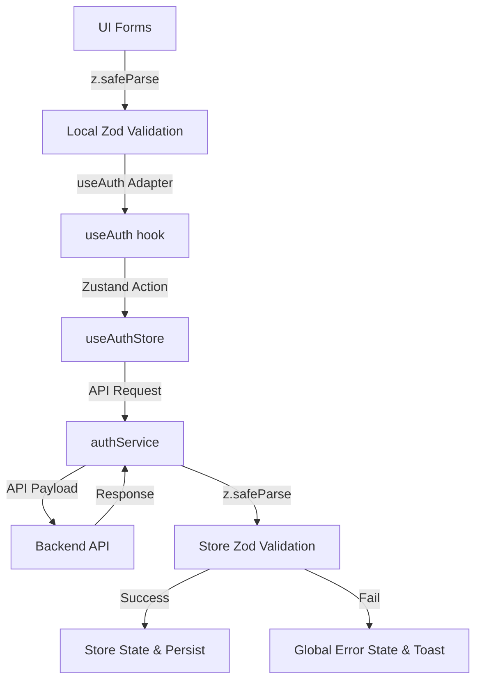

# Zari & Co - Frontend

A professional, state-of-the-art React application built with TypeScript, Vite, and Tailwind CSS. Designed with a luxurious, high-end visual aesthetic and structured using a scalable, feature-composition architecture for production environments.

---

## 🚀 Tech Stack & Core Libraries

- **Framework**: [React 18](https://reactjs.org/)
- **Build Tool**: [Vite 8](https://vitejs.dev/) (extremely fast builds and bundling)
- **Language**: [TypeScript](https://www.typescriptlang.org/)
- **State Management**: [Zustand](https://github.com/pmndrs/zustand) (persistent store, safe hydration)
- **UI Components**: [shadcn/ui](https://ui.shadcn.com/) (primitives customized for luxury styling)
- **Toasts**: [Sonner](https://sonner.dev/) (centralized elegant notification system)
- **Validation**: [Zod](https://zod.dev/) (compulsory validation pipelines on both forms and store actions)
- **HTTP Client**: [Axios](https://axios-http.com/)

---

## 📂 Project Structure

This project enforces a modular **E-Commerce Architecture**, organizing code feature-wise. Generic and global modules are placed in root directories while feature-specific validation schemas live inside feature folders:

```
src/
├── api/                  # Centralized Axios client & interceptors configuration
├── app/                  # Application router registry and context providers
│   └── router.tsx        # React Router v6 mapping
│
├── components/           # Composable UI components
│   ├── common/           # Shared general widgets (e.g. FloatingActions)
│   ├── layout/           # Base framing layouts (e.g. Header, Footer)
│   └── ui/               # Core atomic primitives (Button, Card, Input, Label, Sonner)
│
├── features/             # Domain-specific feature boundaries
│   ├── auth/
│   │   └── validation.ts # Unified Zod validation schemas & inferred types
│   └── catalog/
│       └── components/   # Catalog showcase visual components
│
├── hooks/                # Global custom React hooks
│   └── useAuth.ts        # Unified auth action state adapter hook
│
├── pages/                # Compose feature modules into complete views
│   ├── auth/             # Authentication screens
│   │   ├── LoginPage.tsx # Luxury Sign-In experience
│   │   └── SignupPage.tsx# Luxury Sign-Up experience (includes phone field)
│   ├── Home.tsx          # Homepage view
│   └── NotFound.tsx      # Graceful 404 handler
│
├── services/             # Global network request service modules
│   └── authService.ts    # Centralized auth API request wrapper
│
├── store/                # Persistent Zustand application state stores
│   └── useAuthStore.ts   # Core persistent authentication store
│
├── index.css             # Tailwind setup and visual design tokens
└── main.tsx              # Main entry point mounting `<Toaster />`
```

---

## 🔐 State Management & Zod Pipelines

We combine **Zustand** and **Zod** to build strict, highly type-safe store actions that are immune to silent backend API payload changes:



### Key Principles:
1. **Compulsory Schema Parsing**: Input credentials and profiles are strictly validated on both ends (UI form entry and store data mounting) to capture errors early.
2. **Safe Persistent Hydration**: The authentication session (`user` profile and `token`) is persisted automatically in `localStorage` under the key `'auth-storage'`, allowing immediate hydration upon initial application boot.

---

## 🔔 Centralized Toast Notifications

All visual feedbacks and user updates are routed through our centralized **Sonner Toast System** mounted in `main.tsx`. We implement elegant customized alerts for:
- **Authentication Actions**: Custom-styled toasts for signup, logins, logouts, and connection issues.
- **Validation Warnings**: Concurrently displays inline input highlights and centralized warning toasts.
- **Google OAuth Simulation**: Features premium `.loading()` spinners that dynamically replace themselves with final success or error toasts after a simulated 1.2s delay to match real-world round trips.

---

## 🛠️ Getting Started

### Prerequisites
- Node.js (v18+)
- npm or yarn

### Installation & Run

1. **Install dependencies**:
   ```bash
   npm install
   ```
2. **Setup environment variables**:
   Create a `.env` file in the `frontend` root:
   ```env
   VITE_API_URL=http://localhost:5000/api/v1
   ```
3. **Start Vite development server**:
   ```bash
   npm run dev
   ```
4. **Compile production build**:
   ```bash
   npm run build
   ```

---

## 🎨 Development Guidelines

1. **Absolute Import Paths**: Always use the `@/` path alias pointing to the `src/` root (e.g. `import { useAuth } from '@/hooks/useAuth'`) rather than relative parents (`../../`).
2. **Validations Placement**: Keep validation schemas inside the feature's `validation.ts` file (e.g. `src/features/auth/validation.ts`).
3. **Zustand Stores**: Place global or persistent application stores directly inside `src/store/` to maintain clean state visibility.
